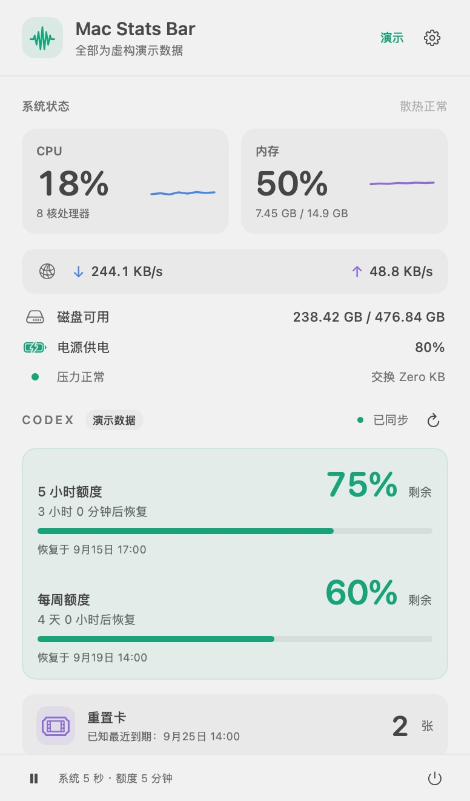

# Mac Stats Bar

一个原生 macOS 菜单栏工具，集中显示系统状态、Codex 订阅额度，并提供菜单栏图标收纳预览。

[← 返回工具箱](../../README.md) · [图文介绍](index.html) · [开发说明](docs/development.md)

## 使用

需要 **macOS 13+** 和 **Apple Command Line Tools**。Codex 额度另外需要本机安装 Codex 并登录 ChatGPT 账户。

从仓库根目录运行：

```sh
./tools/mac-stats-bar/scripts/build.sh
open "tools/mac-stats-bar/dist/Mac Stats Bar Preview.app"
```

默认生成 **Mac Stats Bar Preview.app**。脚本会自行定位工具目录；也可以进入 `tools/mac-stats-bar/` 后运行 `./scripts/build.sh`。

点击菜单栏的**小箭头**展开刘海下方的收纳托盘；右键点击箭头打开系统与额度详情，托盘中的状态卡片也可进入详情。应用不占 Dock 位置。

默认菜单栏只显示小箭头。关闭设置中的「菜单栏只显示小箭头」，可恢复 `CPU 12% · C 76%` 读数。`C` 是选中额度组的剩余百分比；同时有多个窗口时显示其中最小值。



截图使用虚构演示数据。

## 功能

| 模块 | 内容 | 默认刷新 |
| --- | --- | --- |
| CPU | 整机使用率、短期趋势、核心数、系统散热状态 | 5 秒 |
| 内存 | 已用 / 总量、趋势、内存压力、交换空间 | 5 秒 |
| 网络 | 物理接口下载、上传速率 | 5 秒 |
| 磁盘 | 主目录所在卷可用 / 总容量 | 30 秒 |
| 电池 | 电量和供电状态，有内置电池时显示 | 30 秒 |
| Codex | 各额度组余量、实际窗口长度、恢复日期与倒计时 | 5 分钟 |
| 重置卡 | 服务返回的可用张数、已知最近到期时间 | 随额度同步 |

支持手动同步、自动刷新暂停、休眠暂停与唤醒恢复、浅色 / 深色随系统、可选登录启动。

重置卡当前提供**展示**；可通过「用量详情」前往 Codex 管理。应用不会自动消费重置卡。

## 收纳托盘预览

- 托盘显示真实系统状态、Codex 余量、恢复时间与重置卡数量。
- 点击「连接菜单栏应用」，在 macOS 辅助功能设置中允许预览版访问，然后重新打开托盘。可查找并打开其他应用提供的菜单栏项。
- 图标使用应用图标；点击调用该应用自己的菜单。右键菜单可调整托盘内顺序，并在应用支持时打开它的右键菜单。
- 「整理菜单栏」会添加一条分隔线。按住 ⌘ 将希望隐藏的图标拖到线左侧，再点击「完成并收起」。完成后主菜单栏隐藏这批图标，托盘只显示这些收纳项。箭头应保持在线右侧。
- 「重新整理」用于调整收纳范围。「停止收纳，恢复全部图标」放在右下角的更多菜单中。
- 操作外部菜单前会临时展开原图标；下次关闭托盘时再收起。停止收纳、关闭托盘功能或退出应用会恢复显示。
- 托盘只在打开或手动刷新时扫描菜单栏项。无需录屏权限，不截取桌面。

托盘基于公开辅助功能接口，不同应用提供的菜单操作有所不同。图标使用应用图标，菜单仍由原应用定位；尚未实现原图标外观复制、菜单定位到第二排和原生图标拖拽排序。

休眠或屏幕布局变化后会保留收纳范围，并尝试恢复收起状态。如果菜单栏位置尚未恢复，可从更多菜单收起图标，或点击「重新整理」。退出应用会恢复原图标。早期版本的验证记录见 [托盘预览记录](docs/history/tray-verification.md)。

## 辅助功能授权

默认构建使用临时签名。更新或更换应用位置后，macOS 可能仍显示旧条目已授权，而新构建无法访问。退出应用，在「系统设置 → 隐私与安全性 → 辅助功能」移除旧条目，再添加当前构建并重新打开。

固定签名身份和构建参数见 [开发说明](docs/development.md#构建版本与签名)。

## 开发与记录

- [开发说明](docs/development.md)：源码布局、构建参数、数据来源、采样方式、测试与诊断。
- [迁入记录](docs/history/integration.md)：2026-09-15 迁入工具箱的来源与当时的验证结果。
- [托盘预览记录](docs/history/tray-verification.md) · [初版验证记录](docs/history/baseline-verification.md) · [发布隐私记录](docs/history/privacy-review.md)。

本工具随 Screwdriver 使用仓库根目录的 [MIT License](../../LICENSE)。
