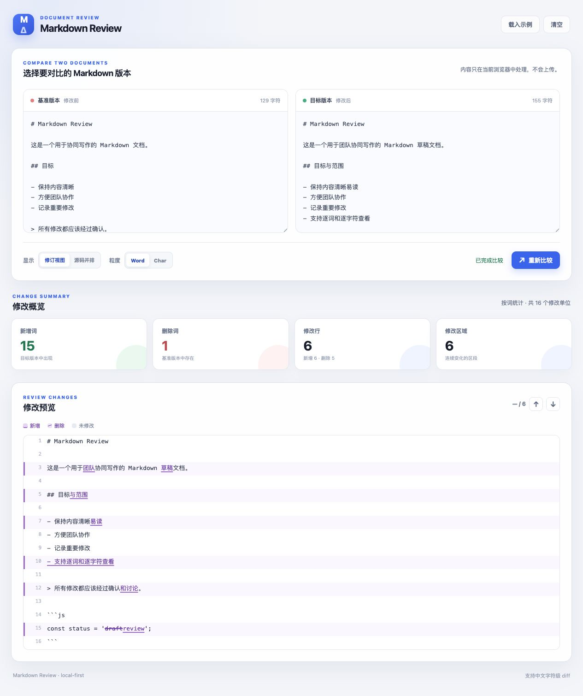

# Markdown Review

对比两份 Markdown 文档，提供类似 Overleaf Review 的行内修订视图和源码并排视图。

[← 返回工具箱](../../README.md) · [打开工具](index.html)

## 使用

1. 用浏览器打开本目录的 `index.html`。
2. 在左侧粘贴修改前的内容，在右侧粘贴修改后的内容；输入后自动更新差异，也可点击「重新比较」。
3. 选择「修订视图」或「源码并排」，按需要切换 Word / Char 粒度。
4. 查看修改统计，通过上一个 / 下一个按钮逐处跳转。

点击「载入示例」可直接体验。内容只在当前浏览器中处理，不上传文档。

## 功能

- **修订视图**：新增内容带下划线，删除内容带删除线。
- **源码并排**：左右查看修改前后各行内容。
- **差异粒度**：英文可按词查看，中文可按字符查看。
- **修改统计**：新增与删除数量、修改行数和连续修改区域。
- **修改导航**：定位上一处或下一处变化。

## 开发

| 文件 | 内容 |
| --- | --- |
| `index.html` | 页面结构与输入控件 |
| `app.js` | 输入、差异渲染、统计与导航交互 |
| `diff-engine.js` | 行级和词 / 字符级差异计算 |
| `styles.css` | 对比工具专用样式 |
| `../../assets/base.css` | 工具箱共用基础样式 |

直接修改对应文件并刷新页面。从工具箱首页进入时，会加载同一份实现。
