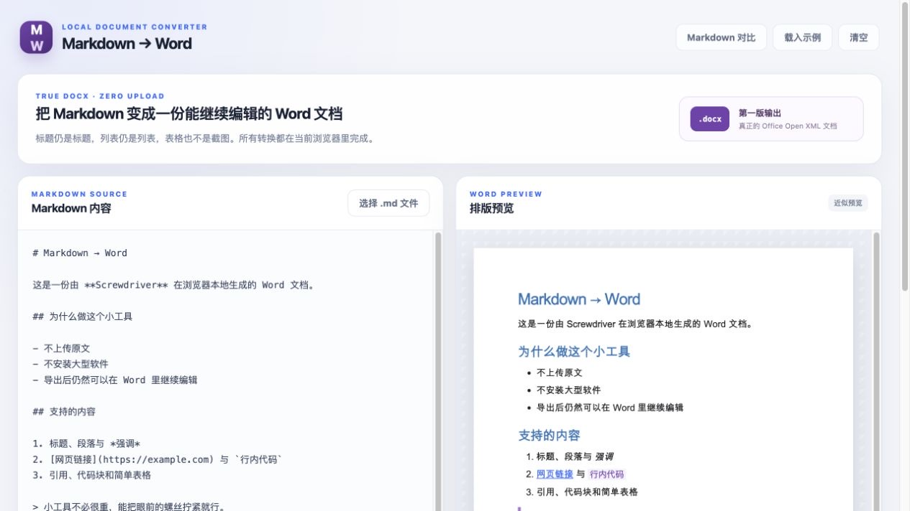

# Markdown → Word

粘贴 Markdown 或拖入 `.md` 文件，在浏览器中生成可继续编辑的 `.docx` 文档。

[← 返回工具箱](../../README.md) · [打开工具](index.html)

## 使用

1. 用浏览器打开本目录的 `index.html`。
2. 粘贴 Markdown，或选择 / 拖入 `.md` 文件。
3. 在右侧查看近似排版预览，填写输出文件名。
4. 点击「导出 .docx」，用 Word 打开生成的文档。

读取、预览和生成都在当前浏览器中完成，不上传文档。导入文件上限为 5 MB。



## 支持格式

- 1–6 级标题、段落、粗体、斜体、删除线、链接和行内代码。
- 有序 / 无序列表、引用、代码块、分隔线和简单表格。
- 标题、列表和表格保留为可编辑的 Word 元素；文件名自动清理并补上 `.docx` 后缀。

图片目前保留为替代文字；输出格式为 `.docx`，不支持老式二进制 `.doc`。

## 开发

| 文件 | 内容 |
| --- | --- |
| `index.html` | 输入、预览与导出界面 |
| `app.js` | 文件读取、预览更新与下载交互 |
| `docx-engine.js` | Markdown 解析、预览 HTML 与 DOCX 生成 |
| `styles.css` | 转换工具专用样式 |
| `tests/` | 引擎测试与示例文档生成脚本 |
| `../../assets/base.css` | 工具箱共用基础样式 |

以下命令在仓库根目录运行：

```sh
node --test tools/md-to-docx/tests/docx-engine.test.js
```

需要检查生成的 Word 文档时，可运行已有的示例脚本：

```sh
node tools/md-to-docx/tests/generate-docx-fixture.js tools/md-to-docx/dist/sample.docx
```

生成的示例放在被忽略的 `dist/` 目录中。
